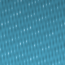
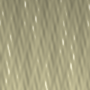

# FlowFX

**Physically based water and flow for Blender** — part of [OpenSimFX](https://github.com/opensimfx),
alongside BlastFX, RainFX and AtmosFX.





_Renders: headless Cycles, preview quality (`tools/render_preview.py`). They are validation checks, not showpieces._

FlowFX builds water for Blender from physical parameters instead of hand-keyframed noise. 21 SI-unit presets cover still water and ponds, ocean from calm to storm, rivers and rapids, streams, waterfalls, dam breaks, floods, tsunami bores, breaking surf and boat wakes.

Three engines sit behind one workflow: a spectral ocean solver that solves for a target significant wave height, a shallow-water heightfield solver for rivers and floods, and Mantaflow for dam breaks and waterfalls. Terrain, obstacles, inflows and outflows are roles you set on your own objects.

## Features

- **21 SI-unit presets** — Still water, pond, lake, ocean, swell, storm, choppy waves, rivers, rapids, streams, waterfalls, dam break, flash flood, tsunami bore, breaking surf and boat wakes — with real dimensions, not arbitrary slider values.
- **Three engines, one workflow** — Spectral ocean, shallow-water heightfield and Mantaflow sit behind the same panels, roles, estimates and cache system.
- **Calibrated wave heights** — Ocean presets solve for a target significant wave height and report the residual, so a two-metre swell is two metres.
- **Roles on your own geometry** — Mark terrain, obstacles, inflows and outflows in the viewport; the solvers read the tags instead of a separate setup dialog.
- **Estimates before you bake** — RAM and disk estimates, cache locations and a diagnostic issue report for every body, before a single frame is simulated.
- **Shading and whitewater** — Water materials with depth-based absorption, foam and whitewater brushes, floaters that ride the surface, and a compositor setup for spray and underwater passes.

## Install

Requires Blender **5.2 LTS or newer**.

```bash
python tools/build_extension.py        # -> dist/flowfx-<version>.zip
```

In Blender: *Preferences > Get Extensions > Install from Disk…*, pick the zip. The panel appears in the 3D Viewport sidebar (**N**) under **FlowFX**.

The repository ships a demo scene (`scenes/flowfx_demo.blend`) built from the dam-break preset, and every preset can be dropped into any scene from the FlowFX tab.

## Quick start

1. Open the **FlowFX** tab, Presets: pick a category and a preset (for example *Lake*), press **Create Water Body**.
2. Spectral presets build an Ocean surface calibrated to the preset wave height and animate with a driver. Play the timeline.
3. Fluid presets build a Mantaflow domain with scenery, sources, sinks and obstacles. Bake from **Cache and Bake**.
4. Heightfield presets: **Bake** solves the shallow-water equations and writes EXR sequences that drive a Displace modifier.
5. **Roles and Coupling** adds obstacles, sources, sinks, a piston wavemaker and floating objects.

Full guide: `docs/user_guide.md`.

## Verification status (read this)

Verified on **Blender 5.2.1 LTS (`bpy` wheel 5.2.2, Python 3.13)**:

- 93 tests pass in the `bpy` 5.2.2 module: 76 unit, API contract and integration, 13 forked fluid, 4 slow validation.
- Extension packaging: built and validated via `blender_ext.py validate` and `build`; `dist/flowfx-0.1.0-alpha.zip`.
- Spectral engine (Ocean modifier): 10 surface presets build, calibrate and bake EXR in tests; held-out Hs errors in `docs/validation_report.md`.
- Heightfield engine (shallow water): Lake-at-rest, mass, wave speed, Ritter dam break, Manning all measured; displaced mesh equals baked pixels.
- Fluid engine (Mantaflow): **Bakes run and match theory** — dam-break front 5.96 m/s against Ritter 6.26 m/s (4.9%), river inflow delivers the designed 0.5 m cross-section (`docs/fluid_validation.md`).
- Floater solver: Heave period 0.01% and draft 0.00% from theory; bakes keyframes.
- Dynamic Paint interaction: Builds canvas and brushes; settings read back.
- Shading, volume, compositing: Cycles absorption verified exactly against Beer-Lambert; real renders in `docs/previews.md`.

**Not verified** — treat as unknown:

- Blender versions other than 5.2 LTS.
- Mantaflow bakes in headless mode (the PyPI `bpy` module crashes inside the solver; desktop build required).
- Geometry Nodes fluid backend (probe only; 5.2.2 has no Points-to-Grid or Poisson node).
- FLIP Fluids adapter (detection only).
- Interactive desktop UI session (all 21 presets driven through panel surface headlessly).

## Repository layout

```
flowfx/                 the add-on (what gets zipped)
  core/                 pure Python: theory, scale, presets, schema, calibration, jobs, orchestrator
  bindings/             every Blender identifier string (one place to fix API drift)
  engines/              spectral, fluid, heightfield, gn_flip (probe), external (FLIP Fluids detection)
  services/             water query, floaters, cache, estimates, impulses, EXR io
  builders/             datablock writers: tagging, shading, volume, compositing, obstacles, whitewater, shoreline
  props/ ops/ ui/       Blender classes
  api/                  public API for sibling add-ons
  presets/              21 JSON presets
  assets/               preview swatches and flowfx_assets.blend (materials)
tests/                  unit, api_contract, integration, integration_fluid (forked), validation
tools/                  build, validate, desktop checks, fluid validation, renders, docs
docs/                   user guide, design, theory, API, spikes, roadmap, ADRs, generated reports
dist/                   prebuilt flowfx-0.1.0-alpha.zip and checksum
scenes/                 demo scene and the asset library
```

## Develop

```bash
uv python install 3.13 && uv venv --python 3.13 .venv
uv pip install --python .venv/bin/python bpy numpy pytest pytest-forked ruff
.venv/bin/python tools/run_tests.py          # add --all for slow validation tests
.venv/bin/python tools/build_extension.py    # writes dist/flowfx-<version>.zip
```

See `docs/development.md` and `CONTRIBUTING.md`.

## Documentation

[User Guide](docs/user_guide.md) · [Design](docs/design.md) · [Theory](docs/theory.md) · [API](docs/api.md) · [Fluid Validation](docs/fluid_validation.md) · [Previews](docs/previews.md) · [Roadmap](docs/roadmap.md) · [CHANGELOG](CHANGELOG.md)

## License

GPL-3.0-or-later (required for Blender add-ons) — see `LICENSE` in the repository.

Reference files from the research phase carry their own licences and are **not** included; see `docs/assets_provenance.md`.