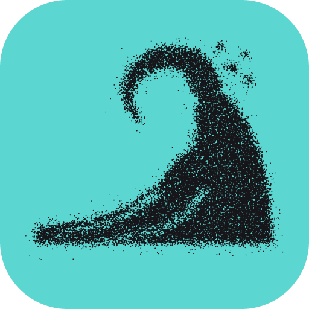
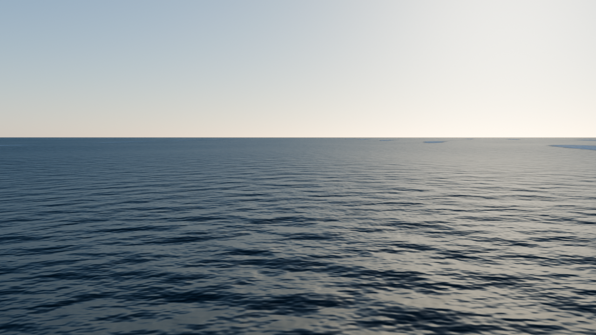
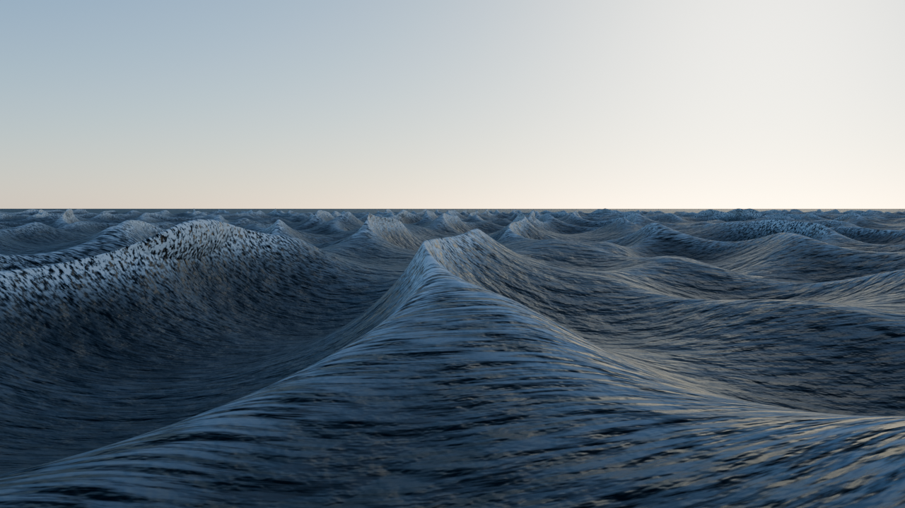
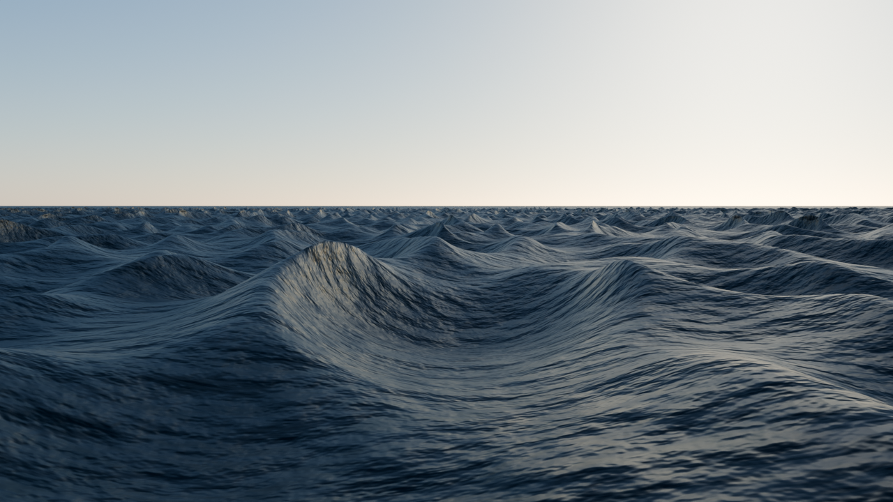
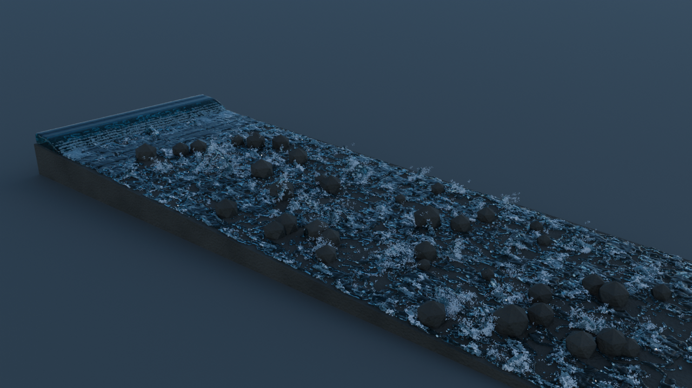
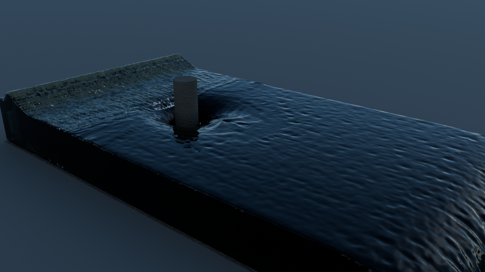
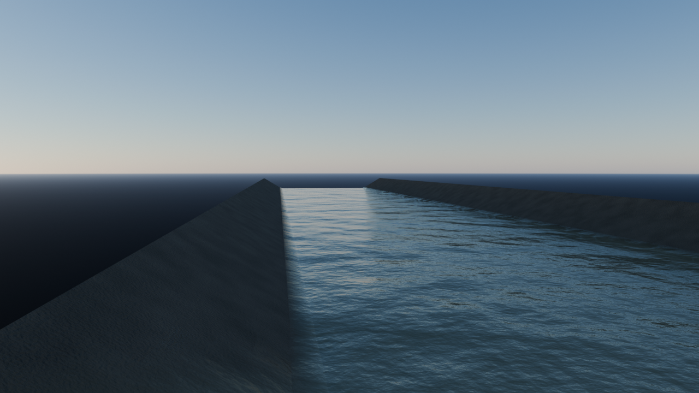
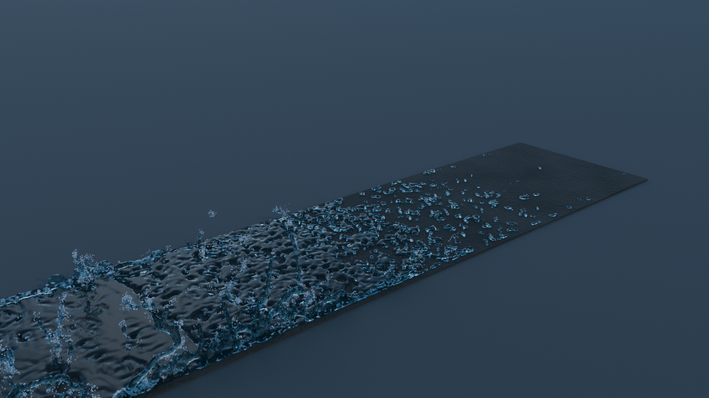
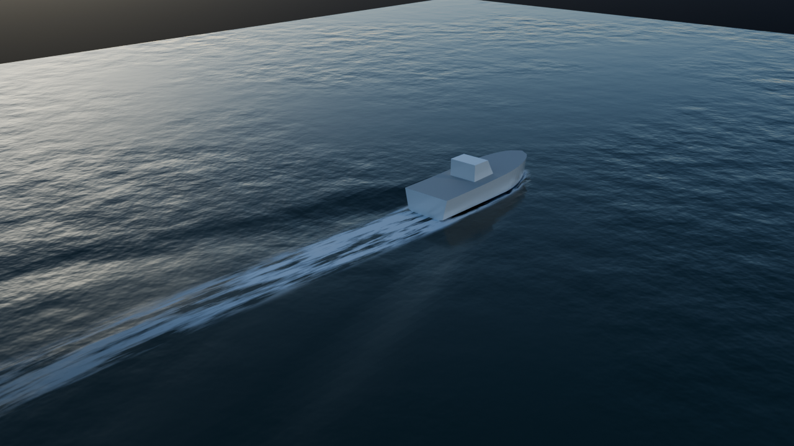
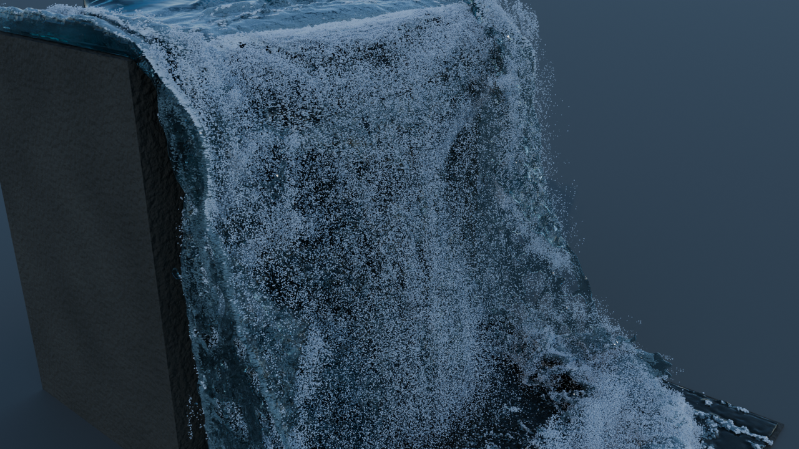

<h1>&nbsp;FlowFX</h1>

**Physically based water and flow for Blender** — part of [OpenSimFX](https://github.com/opensimfx),
alongside BlastFX, RainFX and AtmosFX.



| | |
|---|---|
|  |  |
|  |  |
|  |  |
|  |  |

_Renders: desktop Blender 5.2.3, Cycles, 128 samples, straight from `tools/render_look.py` under a physical sky,
Mantaflow presets at High quality. No compositing._

FlowFX builds water for Blender from physical parameters instead of hand-keyframed noise. 21 SI-unit presets cover still water and ponds, ocean from calm to storm, rivers and rapids, streams, waterfalls, dam breaks, floods, tsunami bores, breaking surf and boat wakes.

Three engines sit behind one workflow: a spectral ocean solver that solves for a target significant wave height, a shallow-water heightfield solver for rivers and floods, and Mantaflow for dam breaks and waterfalls. Terrain, obstacles, inflows and outflows are roles you set on your own objects.

## Features

- **21 SI-unit presets** — Still water, pond, lake, ocean, swell, storm, choppy waves, rivers, rapids, streams, waterfalls, dam break, flash flood, tsunami bore, breaking surf and boat wakes — with real dimensions, not arbitrary slider values.
- **Three engines, one workflow** — Spectral ocean, shallow-water heightfield and Mantaflow sit behind the same panels, roles, estimates and cache system.
- **Calibrated wave heights** — Ocean presets solve for a target significant wave height and report the residual, so a two-metre swell is two metres.
- **Calibrated sea look** — Foam covers the measured whitecap share for the wind (Monahan), chop and sun glitter follow the measured sea-surface slopes (Cox and Munk), and the sea reaches the horizon.
- **Roles on your own geometry** — Mark terrain, obstacles, inflows and outflows in the viewport; the solvers read the tags instead of a separate setup dialog.
- **Estimates before you bake** — RAM and disk estimates, cache locations and a diagnostic issue report for every body, before a single frame is simulated.
- **Shading and whitewater** — Water shaded for how it is bounded (open sea, river over its bed, closed liquid), riverbeds under heightfield water, ripples and white water that follow the solved flow, Mantaflow spray and foam rendered as droplets, foam and whitewater brushes, floaters that ride the surface, and a compositor setup for spray and underwater passes.

## Install

Requires Blender **5.2 LTS or newer**.

Download `flowfx-1.0.0.zip` from the [releases](https://github.com/opensimfx/flowfx/releases), or build it:

```bash
python tools/build_extension.py        # -> dist/flowfx-1.0.0.zip
```

In Blender: *Edit > Preferences > Get Extensions > (v) > Install from Disk...*, pick the zip. The panel appears in the 3D Viewport sidebar (**N**) under **FlowFX**.

The repository ships a demo scene (`examples/flowfx_demo.blend`) built from the dam-break preset, and every preset can be dropped into any scene from the FlowFX tab.

## Quick start

1. Open the **FlowFX** tab, Presets: pick a category and a preset (for example *Lake*), press **Create Water Body**.
2. Spectral presets build an Ocean surface calibrated to the preset wave height and animate with a driver. Play the timeline.
3. Fluid presets build a Mantaflow domain with scenery, sources, sinks and obstacles. Bake from **Cache and Bake**.
4. Heightfield presets: **Bake** solves the shallow-water equations and writes EXR sequences that drive a Displace modifier.
5. **Roles and Coupling** adds obstacles, sources, sinks, a piston wavemaker and floating objects.

Full walkthrough: [docs/USER_GUIDE.md](docs/USER_GUIDE.md).

## Verification status (read this)

Verified on **desktop Blender 5.2.3 LTS** and the **`bpy` 5.2.1 module** (Python 3.13), macOS arm64:

- 119 tests pass: 96 unit, API contract and integration, 19 Mantaflow setup tests (one process each), 4 slow
  validation tests. All 21 presets run through the whole panel surface in desktop Blender.
- Spectral engine: 10 surface presets build and calibrate their wave height (held-out errors in
  `docs/VALIDATION.md`); foam matches the whitecap share for the wind (1.8 % at 12 m/s, 22.6 % at 25 m/s); chop and
  roughness reproduce the Cox-Munk slope variance; open sea reaches the horizon while queries and bakes see one tile;
  presets at their defaults use a precomputed calibration and appear in under 0.3 s.
- Boat wake: the stand-in hull's wake opens at 18.7 deg (Kelvin angle 19.47 deg).
- Heightfield engine: lake at rest, mass, wave speed, Ritter dam break and Manning measured; displaced mesh equals
  baked pixels; dry ground shows the riverbed; ripples and white water come from the baked velocity and foam mask.
- Fluid engine (Mantaflow): dam-break front 5.96 m/s against Ritter's 6.26 m/s (4.9 %); river inflow delivers the
  designed cross-section; spray and foam particles render in Cycles.
- Floaters: heave period and draft within 0.01 % of theory. Cycles absorption matches Beer-Lambert.
- A scene saved by 0.2.0-alpha opens and upgrades in place; caches are stored relative to the .blend; data EXRs
  round-trip exactly; the ocean driver runs with Python auto-run off.
- CI runs every test on Linux, Windows and macOS (`bpy` module) and, on Linux with Blender 5.2.3 and 5.2.4, builds
  and validates the zip, installs it in a clean profile and drives all 21 presets, bakes the dam break in
  Mantaflow and renders the sea in Cycles.

**Not verified** — treat as unknown:

- Interactive Windows and Linux sessions; GPU rendering.
- Mantaflow bakes with the PyPI `bpy` module (it crashes inside the solver; desktop Blender required, which is what
  the panel uses).
- The Geometry Nodes fluid backend (probe only; Blender 5.2 has no Points-to-Grid or Poisson node) and the FLIP
  Fluids adapter (detection only): neither is exposed in the panel.

## Repository layout

```
flowfx/                 the add-on (this folder is what the extension zip contains)
  core/                 pure Python: theory, scale, presets, schema, calibration, jobs, orchestrator
  bindings/             every Blender identifier string (one place to fix API drift)
  engines/              spectral, fluid, heightfield, gn_flip (probe), external (FLIP Fluids detection)
  services/             water query, floaters, cache, estimates, impulses, EXR io
  builders/             datablock writers: tagging, shading, volume, compositing, obstacles, whitewater, shoreline
  props/ ops/ ui/       Blender classes
  api/                  public API for sibling add-ons
  presets/              21 JSON presets
  assets/               preview swatches and flowfx_assets.blend (materials)
tests/                  unit, api_contract, integration, integration_fluid (forked), validation
tools/                  build, validate, desktop checks, fluid validation, renders, docs
docs/                   user guide, presets, physics, system design, development, validation, references, roadmap, UI style
examples/               demo scene
```

## Develop

```bash
uv python install 3.13 && uv venv --python 3.13 .venv
uv pip install --python .venv/bin/python bpy numpy pytest ruff
.venv/bin/python tools/run_tests.py          # add --all for slow validation tests
/Applications/Blender.app/Contents/MacOS/Blender -b --factory-startup --python tools/render_look.py -- \
    sea ocean_moderate docs/img/sea_ocean_moderate.png 128 40                     # README renders
.venv/bin/python tools/build_extension.py    # writes dist/flowfx-<version>.zip
```

See [docs/DEVELOPMENT.md](docs/DEVELOPMENT.md) and [CONTRIBUTING.md](CONTRIBUTING.md).

## Documentation

[User guide](docs/USER_GUIDE.md) · [Presets](docs/PRESETS.md) · [Physics](docs/PHYSICS.md) ·
[System design](docs/SYSTEM_DESIGN.md) · [Development](docs/DEVELOPMENT.md) · [Validation](docs/VALIDATION.md) ·
[References](docs/REFERENCES.md) · [Roadmap](docs/ROADMAP.md) · [UI style](docs/UI_STYLE.md) · [Changelog](CHANGELOG.md)

## License

GPL-3.0-or-later — see [LICENSE](LICENSE).

FlowFX is original work and bundles no third-party assets; see [docs/REFERENCES.md](docs/REFERENCES.md).
